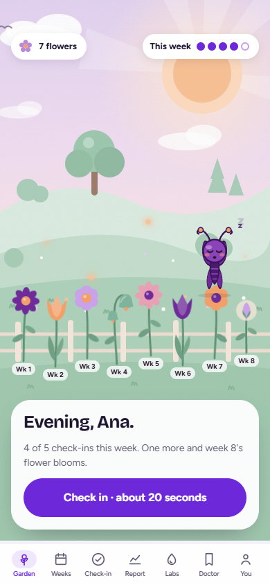
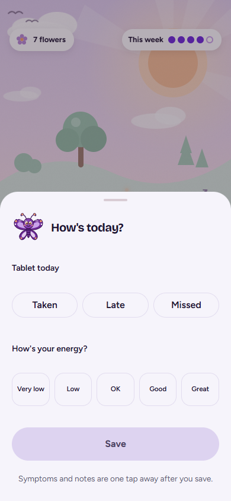
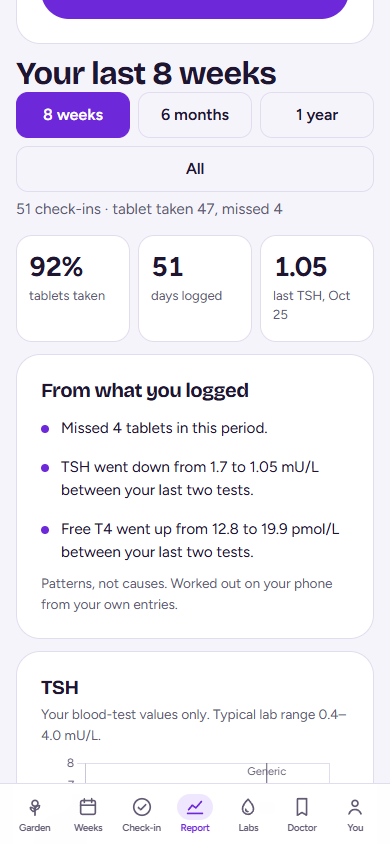
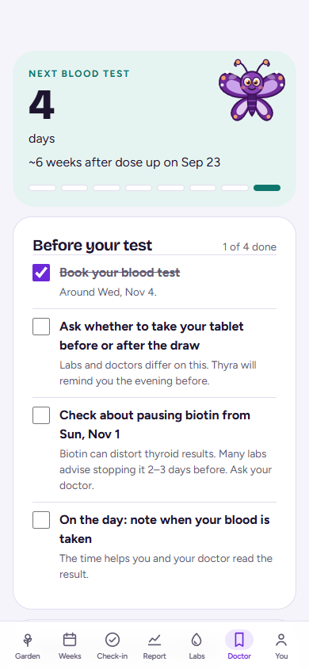

# Thyra

Thyra is for people on levothyroxine. Log your tablet and how you feel in under a minute a day, keep lab results and dose changes in one place, and bring one clear page to your doctor.

**[Download Thyra.apk](https://github.com/RomanoRandic/t-tensor/releases/download/v1.0.0/Thyra.apk)** · [all releases](https://github.com/RomanoRandic/t-tensor/releases)

Thyra helps you spot patterns. It does not diagnose you or tell you to change your dose. That stays between you and your doctor. Everything you log stays on your phone.

The pictures below are a **synthetic demo patient** (Ana), so the labs and symptoms are not a real record.

## Why

Blood tests are weeks apart while a dose is adjusted, then often only once a year. Tiredness, brain fog and the days you felt fine in between never get written down. At the appointment you are describing months from memory.

Levothyroxine is usually taken on an empty stomach, 30–60 minutes before breakfast, and apart from coffee, calcium and iron. That is easy to slip on, and a missed or late tablet is hard to remember later. Your own instructions may differ. Follow your doctor and pharmacist. Sources: [DailyMed](https://dailymed.nlm.nih.gov/dailymed/search.cfm?query=levothyroxine) prescribing information, and the American Thyroid Association [Guidelines for the Treatment of Hypothyroidism](https://doi.org/10.1089/thy.2014.0028) (*Thyroid*, 2014).

Thyra is the notebook for that gap: one tap for the tablet, a few taps for how you feel, and a page you can hand over.

## What the Android app does



**A garden for the days you show up.** Each week of check-ins can grow a flower. The companion on the home screen is asleep until you log today. Five check-ins in a week and that week's flower blooms.



**A check-in that takes well under a minute.** Say whether today's tablet was taken, late or missed, then how you feel. Symptoms, a short note, and tags such as bad sleep, stress, or your period are one more tap after you save. A daily reminder can ring at the time you take the tablet, even when Thyra is closed. **Taken** marks the tablet. **Snooze** waits 15 minutes.



**Labs, dose and symptoms on one timeline.** The report puts how often the tablet was taken next to your TSH and what you logged. Patterns are worked out on the phone from your own entries. They are clues, not causes.



**One page before the visit.** The Doctor tab counts down to the next blood test and lists what to sort out beforehand: booking, whether to take the tablet before the draw, biotin, and the time of the blood draw. You can keep questions for the appointment and share a short summary.

You can also add lab results and dose changes under **Labs**, look back under **Weeks**, and change the reminder, profile and companion under **You → Settings**.

## How to use it

1. Download [Thyra.apk](https://github.com/RomanoRandic/t-tensor/releases/download/v1.0.0/Thyra.apk) on the phone, or copy it across from a computer.
2. Open the file. If Android blocks it, allow installs from that app (Files, Chrome, or whichever app you opened it with), then try again.
3. On the first screen, read the notice and tick the box. Thyra is a research prototype, not a medical device.
4. Set up your profile: name, dose, when you take the tablet, other medicines, and your latest labs if you have them. Anything that is not required can wait. Or tap **Explore with a demo patient** to look around first.
5. Turn on the tablet reminder and set it to the time you actually take levothyroxine. You can change it later in Settings.
6. Each day, open **Garden** and check in. Late still counts as taken. A missed day does not wipe the week.
7. When a blood test comes back, add it under **Labs**, including whether you took the tablet before the draw.
8. Before the appointment, open **Doctor**, finish the preparation list, and share the summary.

Your data is not uploaded. Export or delete it from Settings if you want a copy or a clean start.

## What this version does not do

Thyra for iPhone, logging by voice, scanning a photo of a lab report, smartwatch sleep or heart rate, and answers that cite guidelines are not in this build. The app will say so where those ideas appear.

## Privacy

Check-ins, doses and lab results stay on the device. Thyra does not sell data and does not use ad trackers. The model that looks for patterns runs on the phone.

## Developing

The Android app lives in [`mobile/`](mobile/README.md). The marketing site is the Next.js app at the repository root.

```bash
cd mobile
npm install
npm run dev
```
